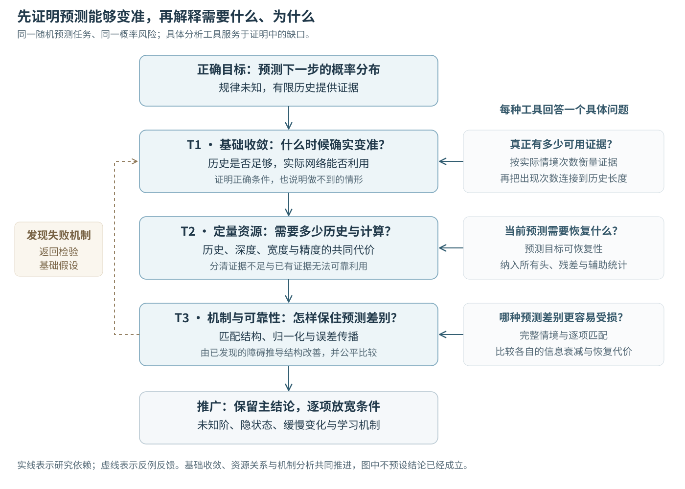
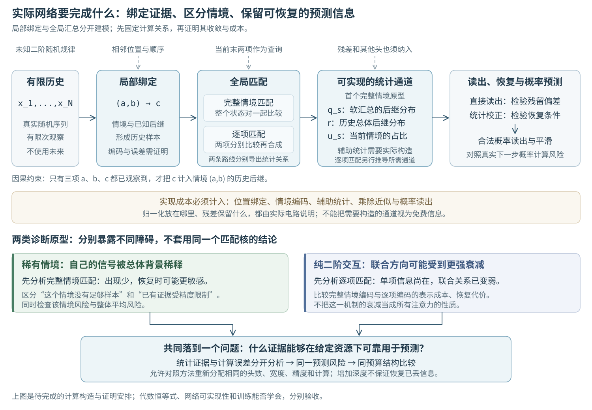

# 二阶概率预测的收敛：Transformer 的长期理论研究方案

> 2026年10月24日 · v10  
> 研究目标：建立从概率预测收敛，到历史与深度的定量关系，再到归一化和计算可靠性的完整理论。

## 一、我们要回答的一个主问题

**面对转移规律未知的二阶随机过程，Transformer 在什么条件下能够越预测越准；要达到给定精度，需要多少历史、多少计算；归一化与小扰动怎样改变这些条件？**

这就是整项研究的中心。第一步要证明预测确实趋向正确的概率分布。第二步把“足够长的历史、足够多的计算”变成有解释力的定量关系。第三步解释温度、归一化和误差为什么会改变这条关系。最后，再把得到的认识扩展到未知阶、隐藏状态和变化中的规律。

这里的“二阶”有一个具体含义：下一步的概率取决于最近两项的联合情况。序列仍然是随机的，不要求周期重复，也不要求下一项由过去唯一决定。我们研究一族未知规律，以及能够处理这些规律的 Transformer。

**图1怎么读。** 中间是必须首尾相接的三组理论结果。右侧的分析方法为它们解决具体困难；左侧的反例帮助我们修正过强的条件。任何一个分支的结果，都要回答它对“正确概率预测”有什么影响。

我们最早提出的“二阶上下文预测何时收敛”是总问题，后来的“二阶结构、有限前缀和归一化怎样影响误差传播”是解释这件事的机制路线。两者应当串联。下面的方案把它们放回同一个模型中。

**计划的核心想法是：网络必须把能够支持同一种预测的证据汇总起来，同时保住会改变下一步分布的情境差别。** 我们将研究这些差别何时被保留、何时被压缩、何时仍能通过后续计算恢复。收敛、深度和可靠性由此有了共同的分析对象。

先用一本天气记录理解整项研究：证据不够，还是没有用好？

想象我们只有晴、雨两种天气，要根据过去预测明天下雨的概率。某个随机世界的规律需要昨天和今天一起看：两天相同时，下一天下雨的概率较高；两天不同时，概率较低。只看其中一天会漏掉这个关系。天气在这里是解释用的随机模型，正式结论面对一族不同的转移规律。

模型不知道规律，只有一本历史记录。在某份记录里，“昨天晴、今天晴”之后有80%的日子下了雨，而全部记录的平均下雨比例是50%。80%目前只是这本记录中的经验；记录足够多、条件合适时，我们才希望它逐渐接近真实概率。

模型寻找类似历史，却也读进其他情况。一种软匹配的计算结果等价于“当前情境经验占三分之一，全部记录的平均占三分之二”，于是输出60%。即使记录越来越多，只要真实长期比例和这种混合份额保持相应关系，直接输出仍会接近60%。错误来自读证据的方式，多翻几页未必能纠正。

如果模型同时保留50%的背景和这次混合的份额，就能用3×60%−2×50%=80%，恢复原来那份经验。恢复后是不是准确预测，还要检查历史本身是否足够。我们要分别证明“读对了证据”和“证据接近真实规律”。

恢复也有代价。背景值精确时，60%的汇总值若多出0.1个百分点，这个例子里的恢复结果就会多出0.3个百分点。情境很少见时，它在汇总中的有效份额更小，恢复可能更敏感。若细小差别已经被舍入或表示丢失，后面多算几层也未必能补回。

因此，T1问这种机器能否逐渐给出正确概率；T2问需要多少记录、多少层及多大表示和精度；T3问怎样安排匹配、归一化和残差，才能保住关键差别。两项分别匹配还可能淡化它们之间的联合关系，所以我们比较不同编码方式，并把额外成本计入。

可以用三个问题自检：多看历史为什么不总有用？因为可能仍在用有偏的方式汇总。能校正为什么不等于已经学会规律？因为校正首先恢复的是有限历史经验。多算为什么不总能解决？因为需要的证据可能从未出现，或已被不可恢复地丢掉。

## 二、先说清楚：这个模型实际在做什么

设我们观察到一段序列，却不知道它的转移规律。例如，同样是“今天下雨”，昨天晴天与昨天雨天，可能对应不同的明天下雨概率。最近两项告诉我们现在属于哪种情况；更长的历史帮助我们认识这种情况之后通常会发生什么。

**知道规律时，最后两项足以预测。规律未知时，历史的作用是估计规律。** 因而，一个二阶过程完全可以需要很长的学习上下文。这也是我们同时研究二阶结构与历史长度的原因。

我们选择有限字母表上的未知二阶马尔可夫族作为起点：符号种类有限，但转移概率可以在一族规律中变化。它能够包含强或弱的二阶关系、常见或罕见的情境，以及快速或缓慢的样本混合。最初的定理先明确平稳性、可识别性和相关性条件，再逐步放宽。

**图2怎么读。** 网络先识别相邻两项组成的情境，再寻找历史中相应的例子，汇总它们的后继结果，最后输出概率。后续层可以改善筛选和汇总，也可能纠正先前的混合。图中的每个环节都要从实际注意力、残差和读出运算中导出；它是我们要检验的机制，不是对所有 Transformer 的预设描述。

第一批分析采用一个具体的架构起点：带因果掩码和位置表示的 Transformer，用局部注意力形成相邻两项的表示，用内容注意力收集历史后继证据，再用残差计算块处理和读出。先固定一个可分析的头数与宽度配置，分别研究固定层网络及重复同一计算块的深度族。归一化变体随后在同一输入、同一目标和同等资源下比较。

这给出了可以直接开展推导的对象：**相邻情境怎样形成，softmax到底把哪些证据混在一起，残差和后续层又保留了哪些可恢复的信息。** 若一种纠正方法需要额外头、情境查询或存储通道，其成本要进入结果，不能把完整转移表免费交给网络。

### 三个预测对象，放在同一条线上比较

| 对象 | 它知道什么 | 我们用它回答什么 |
|---|---|---|
| 真实规律给出的预测 | 知道实际转移规律和当前两项 | 最终应接近的概率是什么 |
| 同历史的统计参照 | 只看到与网络相同的过去 | 这份证据本来最多能支持多好的预测 |
| Transformer输出 | 从相同历史经过指定网络计算 | 网络利用这些证据的能力与代价是什么 |

我们主要看概率分布的差距和额外对数损失。例如真实概率是80%，准确预测应接近80%；下一次事件偶然没发生，并不表示这个概率判断错了。

有限前缀有两种作用，需要同时分析。其一，某些情境还没有出现足够多次，统计证据不足。其二，开头的位置缺少完整上下文，真实因果计算中的分母、位置特征和早期表示不同。前者属于信息不足，后者属于计算边界；它们会在网络中相互影响。

模型、因果索引与参数约定

记历史长度为N，计算深度为L，真实规律为θ，当前情境为S=(X[N−1],X[N])，目标为Y=X[N+1]。给定θ后，下一步条件概率是Pθ(Y|S)。每个完整历史位置3≤j≤N可提供已观察的例子(X[j−2],X[j−1];X[j])；前两个位置单独屏蔽或使用已定义的起始标记。目标Y从不进入输入或历史value。

把相邻两项组成一个状态，可以得到状态对上的一阶链。它只能从(a,b)转到(b,c)，有结构性零元素；一般性条件不能要求所有状态对之间一步互通。

跨任务研究中，每条序列由自己的θ生成，同一套训练所得参数服务新的θ。任务先验已知与由训练数据估计，分别分析。固定同一θ训练和测试则是另一份参数学习设定。模型参数可以依赖哪些已知范围、是否随N重新构造、L是共享块重复还是预先规定的多层网络族，都在每项定理前固定。测试θ及未来标签不用于调参。

起步可以先规定有限的非零转移下界和混合条件，建立完整定理；然后研究常数在罕见情境、慢混合和小概率方向上怎样退化。这些条件应当成为可分析的量，而不是永久固定的便利假设。

## 三、两条具体路线：软汇总后的恢复，二阶交互的保留

现在把“预测差别能否保留和恢复”落实到两种可以直接分析的计算。第一种把整个二阶情境当作一个类别；第二种分别比较情境中的两项。它们都使用有限分差的softmax，却会以不同方式改变预测信息。比较它们，能把数据结构与网络结构真正联系起来。

### 路线A：从软汇总中恢复当前情境的经验

假设一段历史中，“最近两天天气都晴”的情境之后，有80%的记录下了雨；全部合法记录中，下雨的比例是50%。网络寻找相似历史时，也读入了其他情境的记录，因此可能输出60%。这首先是一份有限历史上的计算结果。如果真实过程的长期条件概率确实是80%、总体比例是50%，而汇总的混合份额也趋于同一值，那么增加历史会让这个直接输出稳定在60%左右。证据越来越充分，输出却仍有偏差。

我们要问：这次汇总是否真的丢掉了所需信息，还是把它变成了一种需要额外计算才能读懂的形式？

令当前情境为s，它在合法历史例子中占比u_s；该情境的经验后继分布为p̂_s，全部合法例子的后继平均分布为r。规定匹配同一情境时加固定分数β>0，其他情境得0分。令γ=exp(β)−1，可以从softmax分子、分母直接推出：

    q_s = (r + γ u_s p̂_s) / (1 + γ u_s)
        = (1 − λ_s) r + λ_s p̂_s，
    λ_s = γ u_s / (1 + γ u_s)。

λ_s就是当前情境的经验在汇总结果中占的有效份额。情境越少见，它的规律越容易被总体背景稀释。只要u_s>0，并且背景和情境占比仍可使用，就能恢复：

    p̂_s = q_s + (q_s − r) / (γ u_s)。

取u_s=1/4、β=log 3时，λ_s=1/3。于是“80%的情境经验＋50%的总体背景”混成60%，校正后又回到80%。**这说明固定的软匹配可以保留足够信息；接下来要研究的是，真实网络怎样取得这些统计，以及多大的计算成本才能把它们可靠地用起来。**

上面的恒等式是已核验的基础关系，不单独承担论文创新。它只适用于所写出的分数和统计通道。下一步必须完成局部绑定、辅助统计、乘除法与概率读出，才能得到Transformer的收敛结论。

路线A的真实电路、有限历史与实现成本

令M=N−2，历史情境S_j=(X[j−2],X[j−1])，已观察后继Y_j=X[j]，3≤j≤N。情境计数为n_s，u_s=n_s/M，r为这M个后继的经验平均。分数取β·1{S_j=s}，softmax分母精确为M+γn_s，分子为Mr+γn_s p̂_s。因此恢复恒等式对每一条有限历史成立，无需先取平稳极限。n_s=0时没有该情境经验，使用预先定义的平滑或退回策略，不能执行除以u_s的恢复。

一个直接实现先用局部复制和前馈层形成情境特征，再由匹配头得到q_s，由均匀汇总头保留后继平均r及各情境频率，最后根据当前情境选出u_s。标准attention的历史value只由历史位置决定，不预知当前query，因此“直接在value里放是否匹配当前情境”不能当作免费操作。

若字母表有K个符号，情境one-hot有K²种。它可实现完整情境的精确相等匹配，但这一直接单头构造需要约K²规模的键查询维度和频率通道。更省的编码、参考通道或多头方案须给出真实实现和代价，后续与逐项匹配比较。

局部绑定与全局汇总分别记账。允许固定局部掩码时，可以准确复制指定前项；只允许一般softmax位置选择时，则显式控制绑定误差。有限分差的全局汇总不意味着局部定位没有成本。已有n-gram插值构造也区分这两层：[D’Angelo等，§3.2.1及Proposition 3.1](https://arxiv.org/html/2607.02800v1)。

恢复频率只需要情境占比；判断9/10与900/1000代表多强证据，以及实现按次数变化的贝叶斯平滑，还需要总长度或次数信息。固定有限前馈网络的倒数近似可能留下误差；随精度重新构造的网络族与同一固定网络的渐近收敛，需要分别证明。

### 路线B：分别匹配两项，会怎样改变它们之间的关系

二阶信息有时不在任何一项单独的取值里，而在两项的组合里。例如，把两种符号记作−1和+1，下一项为+1的概率可以是：

    P(+1 | a,b) = 1/2 + θ ab，|θ| < 1/2。

两项相同与不同，对应不同的下一步概率。在均匀平稳的情境分布下，最近两项中的任一项单独看都不能改善预测；θ≠0时，它们的乘积ab却携带预测信息。这里得到的是带随机性的二阶过程，轨迹不要求周期重复。

如果网络给候选情境(c,d)的分数是β₁ac+β₂bd，其中β₁、β₂>0，它分别比较两项，然后把分数相加。在总体情境均匀时，单项方向的信号分别缩成tanh β₁、tanh β₂倍，而联合方向缩成两者的乘积：

    q(a,b) = 1/2 + θ · tanh β₁ · tanh β₂ · ab。

**网络可以还保留着每一项的信息，却把“两项之间的关系”压得更弱。** 这为我们提供了第二个明确研究对象：交互结构与匹配结构之间是否适合，决定恢复预测需要付出多少代价。

路线A和路线B是两种不同的分数机制。对路线A，在四种情境均匀出现时，所有非恒定方向的增益都是γ/(4+γ)，没有单项与二项之间的乘积差异。因此，“联合信息受损更大”是需要按架构说明的机制，不是所有softmax的共同定律。

下一步比较完整情境编码、逐项匹配和显式联合特征：它们使用同样的信息，分别需要多少通道、层数、参数尺度和精度；哪一种能以更小代价保住预测需要的差别。引入联合特征时，其生成和学习成本也进入比较。

路线B的谱结构及有限历史连接

在均匀分布的四个二元情境上，逐项匹配核的归一化分母为4 cosh β₁ cosh β₂。对常数、a、b、ab这四个Walsh基函数，其特征值分别为1、tanh β₁、tanh β₂、tanh β₁ tanh β₂。这是布尔Fourier分析的基本计算，不单独作为新贡献。[相关基础](https://arxiv.org/abs/2105.10386)

上面的随机过程具有均匀平稳状态对分布：对固定b，把前一项a的两种可能求和，下一项为+1的概率和为1。可以因此用它检验纯联合信息；不能随意加入破坏该平稳分布的其他信号后仍沿用同一公式。

有限历史中的情境次数并不精确相等。真实混合矩阵要使用实际频率及真实分母，再证明它与总体算子的差距。非均匀占比、输入准备误差、多头和残差均可能改变谱结构。首轮先控制这些变化，判断联合方向的衰减在多大范围内仍然解释真实概率误差。

稀有情境族与这里的均匀交互族分别检验两种困难。它们可使用相同风险与资源指标比较，但不能把一个族的平稳假设代入另一个族的公式。

### 两条路线怎样合起来

路线A说明：一种规律出现得少时，信息可能被背景稀释；路线B说明：规律包含联合关系时，信息可能被分解式匹配额外压缩。两者都把问题指向同一件事——**完整可见表示还保留了多少预测差别，恢复这些差别会放大多少误差。**

我们以这个共同问题组织接下来的收敛、资源和可靠性证明。若残差或其他头提供了更好的证据，必须一并分析。研究应解释完整网络的能力，而不只描述一个被单独截出来的弱通道。

## 四、三组核心定理：从“会不会正确”走到“怎样可靠地正确”

这一节是计划的主体。三组结果沿用共同的模型与风险定义；每条具体结论注明适用的过程族，并保持前后的数据假设和网络资源可比较。第一组确定正确性与边界，第二组算清代价，第三组解释结构改变与误差承受能力。

### T1：基础收敛——历史中的信息，能否变成正确预测

**我们要证明：在一族真正随机的二阶过程中，当历史证据逐渐充分时，一类明确的Transformer通过筛选或可恢复的混合，能够使下一步概率趋向真实条件分布。** 同时说明哪些信息丢失会使这种收敛不可能。

证明先从同历史的统计参照开始，例如带平滑的情境频率或合适的贝叶斯预测。分析它在相关样本下何时一致、误差怎样依赖情境频率和过程混合。接着，逐步导出网络的相邻绑定、匹配、聚合和读出，证明网络与该参照之间的差距能够被控制。

这一组结果必须区分三种情形：历史本身不够；历史足够但当前网络直接读出了错误混合；混合存在但预测差别可由完整表示恢复。我们要找出它们之间的边界，而不只构造一个理想网络成功的例子。

**第一项具体命题是“固定软混合的预测偏差与可恢复条件”。** 首轮固定有效注意力分差有界，不靠随N或L放大权重、隐藏范数来逼近硬匹配。历史增长时，推导其总体极限；判断直接读出是否留下偏差，并研究有限层后处理能否消除它。若不能，指出缺少的是通道、识别信息，还是不可恢复的表征损失。对实际保留全部残差信息的网络，反例也必须考察全部可见表示。

第一版T1针对明确给定参数或满足可核查机制条件的前向预测过程。训练是否能找到这些参数，沿用同一模型在后续阶段证明。

对路线A，先把经验恒等式接到遍历过程的统计一致性，证明指定直接读出的偏差与校正输出的差别。恢复后的经验概率可能为零，近似运算也可能产生负值；因此，选择明确的概率投影与平滑，并把它们引入的误差计入预测风险。对路线B，先证明实际有限历史下的联合信号怎样保留，再决定需要怎样的恢复或联合特征。

这一项的输出应是一份完整收敛定理，以及与它同条件的失败实例。统计参照一致性和浅层计数表达已有强先例，基础工作应直接承接；新增证明集中于实际网络中的偏差、恢复与概率目标之间的连接。

### T2：定量关系——多少历史与多少计算才能一起够用

有了T1，我们才能进一步回答：精度从10%提高到1%，应该增加历史、增加计算，还是改善表示？我们准备建立联合误差界，并解出这些资源之间的关系。

目标形式可以写成：

    概率误差 ≤ 有限历史的统计误差
             + 当前深度尚未消除的计算偏差
             + 架构实现与输入准备误差。

这只是组织证明的形式。实质工作是把每一项写成同一个N、L和网络结构参数的可计算函数，并证明这些依赖确实反映了机制。

**第二项具体命题是“预测相关方向决定所需深度”。** 对筛选路线，分析深度怎样改变正确与错误情境的相对权重；对校正路线，分析哪些预测差别恢复得快、哪些恢复得慢。比较最坏隐藏方向的界与真正输出概率的界，研究能否得到更准确的深度规律。

**第三项具体命题是“历史与深度存在不可互相替代的部分”。** 如果当前情境几乎没有出现过，继续计算不能创造证据；如果软混合留下固定偏差，再增加样本也不能消除它。争取用合法过程族给出这两种限制，并找出两项资源共同增长时可以消除总误差的区域。

二阶结构在这里直接进入定理。倒数第二项带来的预测收益、相关情境出现的概率、样本相关时间，以及不同情境的预测差别，会共同影响误差。弱二阶、罕见情境和慢混合是检验理论的三种困难情形，不取代总研究目标。

深度也要与宽度、头数、分数尺度及精度一起比较。已有浅层构造可能在某些资源条件下已经足够；这时应证明其充分性，并解释额外层在哪些限制下才有价值。若某类迭代只有中间阶段有用，就刻画有用的深度范围，而不是强求无限加深仍然改善。

路线A的直接校正有可能只需要常数层。T2据此研究深度、宽度与精度之间的替代关系：固定宽度后，更多层能否完成更准确的倒数或特征计算；允许更宽的浅层网络时，是否已能以更低总代价完成同样任务。迭代恢复要与直接校正、已有浅层构造和同预算的强基线比较，层数不能成为人为选用慢算法的结果。

T2的首个合法检验族：情境稀有，但过程整体仍然快速混合

令0<u<1/4，w=(1−u)/3，t∈[1/4,3/4]。按00、01、10、11排列，指定平稳状态对分布π=(u,w,w,w)，对应下一项为1的概率为(t,1/2,1−ut/w,1/2)。转移只允许(a,b)走到(b,c)。直接代入可验证πP=π，所有允许转移严格在0与1之间；总体后继为1的概率恒为2w，与t无关。

00的频率为u，它的后继概率t却可以明显变化。更有用的是，每个起点两步后到11的概率都至少为1/8，所以整体混合速度可以在u趋零时保持统一。这个族将“有关情境太少”与“整个链混合太慢”分开。与此同时，一些允许转移概率会趋零，因此不能再要求一个与u无关的统一正下界。

在平稳初始化下比较t与t′=t+Δ，两者均在指定区间，长度N历史的KL差异精确为：

    (N−2) [u·kl(t,t′) + w·kl((u/w)t,(u/w)t′)]。

这里kl是两个Bernoulli分布的KL。这个量与(N−2)uΔ²同阶，10情境中的稀有转移也贡献同阶信息。因此，它刻画的是完整轨迹的统计可辨别性，不能只解释成观察00后的次数。

总体软读出满足q_00(t)=(2w+γut)/(1+γu)，参数差Δ在该通道中缩为γuΔ/(1+γu)。这些是已经核验的构造性质。要得到有限历史的计算下界，还须控制随机统计量(q_N,r_N,û_N)的联合波动，明确全部可用通道和扰动位置，再证明两种规律的受扰观察难以区分。总体均值相同，并不表示精确保留的波动不携带信息。

首个下界目标采用聚合后有界绝对误差：用集中界使有限历史统计量进入各自总体值附近，再构造落入共同误差范围的观察。随后再研究确定性舍入、独立随机噪声或保留代数关联的误差，不能将不同模型的结论混用。

分别报告指定情境或末位置条件于00的风险，以及按平稳频率平均的风险。仅由00造成的平均损失还要乘以u；真实末位置查询与历史相关，其条件风险需独立证明。这些区分决定论文最终能作出多强的可靠性主张。

### T3：机制与可靠性——归一化改变了什么，误差能承受到哪里

前两组已经有了共同的概率误差和资源关系。这一组在同一个对象内比较具体结构，解释它们怎样改变收敛速度、可用资源范围和扰动放大。

注意力softmax首先改变情境混合；LayerNorm和RMSNorm作用于表示尺度及方向；残差可能保留被混合的原始证据；输出概率层决定最后怎样形成分布。我们按这些实际作用位置比较，而不把所有操作统称为一种归一化。

**第四项具体命题是“归一化的收益应由预测相关方向上的计算条件解释”。** 某种归一化可能让更新更快，也可能缩小必须区分的概率信号。我们将分别控制有效更新幅度和恢复敏感性，比较达到相同预测精度的成本。若效果完全等同于调步长，给出等价条件；若它保留或压掉了不同信息，给出同资源下的差异。

**第五项具体命题是“准确与可靠的共同范围”。** 在层间加入明确的小扰动，沿真实计算追踪它怎样传到输出。对合适的概率距离，争取得到：

    有扰动的预测误差 ≤ 名义预测误差 + δ × G(N,L)。

G表示这些层实际放大和累计误差的程度。把它与T2的名义误差放在一起，判断是否存在足够准确、又仍能可靠实现的深度范围。对数损失需要概率下界或平滑控制，不能未经条件直接套用同样形式。

对路线A，先把误差按进入位置分开。同一份历史的采样误差共同进入q_s、r和u_s，精确恢复后仍是原来的经验频率误差；聚合后新加入、破坏这些关系的误差，才按恢复系数放大。分数误差、局部绑定误差和舍入误差也分别追踪，不统一替换成独立高斯噪声。

T3的第一条稳定性接口：占比和概率通道都不精确时

若u_s精确、q_s与r的逐坐标误差各不超过δ，则恢复后的经验频率误差不超过(2+γu_s)δ/(γu_s)。固定β时，稀有情境会出现约1/u_s的放大。

若u_s也有误差，写e_q=q̃−q、e_r=r̃−r、e_u=ũ−u，且ũ>0，准确恢复函数F(q,r,u)=q+(q−r)/(γu)满足：

    F(q̃,r̃,ũ) − p̂
    = e_q + (e_q−e_r)/(γũ)
      − [(p̂−r)/(1+γu)] · e_u/ũ。

当|e_u|≤u/2，利用概率坐标有界，可逐坐标控制为：

    (1+2/(γu))δ_q + 2δ_r/(γu) + 2δ_u/[u(1+γu)]。

这要求情境占比具有足够的相对准确度。利用真实统计之间的关系后，无需把u的误差粗估为1/u²。以上先控制概率坐标；进入KL风险时，还需明确投影、平滑或概率下界及其代价。

固定绝对精度下可进一步问：软汇总是否引入与log(1/u)有关的额外位数需求，其他证据通道是否能避免。比较的是该机制额外造成的精度代价，不能把固定输出位数无法逼近任意连续概率这一普遍事实当成新发现。

如果发现某个标准结构压低了关键的预测差别，我们再据此提出改进。例如，保留情境身份和证据数量的独立残差通道，或仅对无关幅度作缩放。改进必须在相同信息与明确资源下证明作用；增加一个模块本身不构成结论。

### 三组结果最后要合成什么

最终希望得到一张由定理支持的图：给定一族二阶规律与网络结构，哪些历史长度、深度和扰动水平能够保证指定预测精度；哪些区域受证据不足限制，哪些受计算偏差或恢复不稳定限制。图中每条边界要对应上界、必要性或明确的未解区间。

它会使我们能够回答：**这一次预测不准，究竟应当多看历史、多做计算，还是改变处理信息的方式？** 这才是三组定理合在一起要提供的认识。

## 五、不同视角怎样真正进入证明

下面的视角分别处理T1—T3中的具体缺口，也可以同时参与一项证明。第一轮的核心工具很明确：用实际情境次数分析证据，用恢复条件分析网络还保留了什么，再用交互分解比较两种匹配。其他视角在能够解决具体困难时接入。

### 信息论：确定哪些差别值得保留

首先衡量倒数第二项在最近一项之外，究竟增加多少预测信息。强联合依赖可以在单项关联很弱时存在，因此只按单个位置的相关性筛选，可能错过真正的二阶结构。

接着研究表示是否保住了这些信息。若完整表示把需要不同预测的历史变得不可区分，就能给出读出无法补救的限制。对于未知规律，还要区分“比例”和“证据量”：9/10与900/1000都给出90%的经验比例，却支持不同的不确定性判断。位置、残差或其他头是否保留了次数，必须进入完整模型。

这些分析直接服务T1的可达性和T2的历史下界。已有上下文树加权及其Transformer构造提供了重要参照；我们重点研究这些信息在具体计算中是否稳定可用，而不重新把“会计数”当成创新。[CTW与Transformer预测](https://proceedings.mlr.press/v300/zhou26b.html)

把历史不足与网络不足放进同一风险账本

指定任务先验并固定训练信息后，有限历史C的最佳概率判断是对未知规律的后验平均。使用对数损失，总差距可分成“看完C仍不知道规律的损失”和“网络没有用好C的损失”。如果窗口W是C的函数、表示Z是W的函数，还可以继续拆成截窗损失、表征损失和读出损失。这来自标准条件熵恒等式，用作共同接口。

固定未知θ的频率学分析则使用对应风险，不直接把先验平均互信息解释移过去。训练、推理和算术可能影响同一项风险；细分误差时要由具体计算证明，而不是先贴标签再当作已经解耦。

统计证明优先围绕“实际见过多少次这个情境”展开。给定真实规律，观察下一项之前就已知道当前情境，因此条件计数有自然的鞅差分结构。先按实际次数n_s控制后继频率误差，再用占据次数、覆盖或混合性质联系总长度N。这样能把“等待情境出现”与“每次观察提供的信息”分开。

条件计数的统计接口

固定θ、情境s及输出符号c，定义：

    M_(s,c)(N) = Σ_{j=3}^{N} 1{S_j=s} [1{X_j=c} − p_s(c)]。

相对于逐步观察的历史，它是鞅差分之和，因为S_j在X_j出现之前已经知道。使用自归一化或时间一致的界时，先控制实际计数，再补足零计数、多个情境和随机查询的处理。

末位置query产生的注意力权重可能依赖更晚出现的数据，不能直接当作可预测权重。路线A先将实际attention精确写成计数关系，便能在计数层使用这一工具。对路线B则先导出适当的有限统计接口。

### 泛函与算子分析：研究哪些预测方向还能被恢复

数据过程有自己的条件期望算子，它描述在当前情境下如何预测未来；网络有层间的信息变换，它描述已有证据怎样被加工。我们要建立两者之间的连接。

具体做法是将网络作用分到与预测有关和无关的方向上，研究混合、投影、残差与读出怎样改变它们。可逆性用于判断是否还能恢复，谱及奇异值用于分析恢复速度和敏感性；因果非对称与随层变化时，再使用输入输出增益和算子乘积来控制。

这里的新机会是任务相关的界。一个网络可能在全空间条件很差，但那些最难的方向并不影响当前预测；也可能隐藏状态很稳定，却恰好抹掉了最重要的二阶差别。把这种区分写成定理，能直接提高T2与T3的解释力。

这里采用“只恢复预测目标”的观点：整个转移表未必都能重建，但当前查询所需的概率仍可能读出。对线性接口z=Av、目标ℓᵀv，基础条件是能找到a使Aᵀa=ℓ；这时aᵀz就给出目标。在无穷范数有界的观察误差下，满足条件的a中最小的1范数衡量该目标的恢复敏感性。

这给两条路线一个共同尺度：稀有情境可能使目标信号很小，逐项匹配可能使交互方向很弱；我们比较的是恢复当前预测的代价，而不是要求A在所有方向都好。概率参数需限制在合法差分空间；所有残差与其他头都纳入A或相应的非线性接口。[函数可观测性与目标估计](https://arxiv.org/abs/2201.07256)

线性逆问题、正则化和早停已有成熟理论，应作为方法基础。它们已经处理恢复、随机样本与噪声之间的多种权衡。我们需进一步核对真实Transformer中因果相关数据、输入相关注意力、层间更新及概率读出的组合，哪些可直接承接，哪些仍需新证明。[早停与梯度下降学习](https://web.mit.edu/lrosasco/www/publications/earlystop.pdf)

### 统计物理与动力学：研究筛选、汇总和纠正的时间尺度

softmax与Gibbs权重有严格的形式对应：把匹配分数取负作为能量，温度控制权重对分数差异的响应。其变分形式是在匹配质量和分散程度之间取平衡。这给了我们分析T1中情境混合的具体工具。[softmax的变分结构](https://arxiv.org/abs/1704.00805)

关键并非笼统地问“低温好不好”。需要同时区分两种分差：不同情境之间应该拉开的差异，以及同一情境内部由样本、位置或表征误差引起的无关差异。降温可能帮助排除错误情境，也可能只留下少量偶然样本；若同类证据得分完全相同，降温则不会自动破坏它们之间的平均。我们要推导这些情形的条件，而不是先选一个万能温度。

还要把分数优势与候选数量一起看。若同情境有n_good个例子，其他情境有n_bad个，组内同分而两组有效分差为g，则错误情境的总权重是n_bad/(n_good exp(g)+n_bad)。寻找唯一位置时，数量劣势可能随N扩大；汇总重复情境时，两组都在增加，数量比可能趋于固定值。稀有情境更直接对应log(1/π_s)的匹配代价，而不总是log N。局部绑定和全局统计因此要分开建模。

本计划中的注意力温度影响读取哪些历史；输出采样温度影响如何抽取最终答案；训练中的有效温度属于特定优化噪声近似。它们不互换。概率已经正确时，仅把输出变得更集中，可能使概率判断更不准确。

对深度，重点考察两个时间尺度：同类证据何时汇总充分，预测所需区别何时开始消失。若前者快、后者慢，中间可能出现有用的计算范围；校正路径则进一步研究，能否在差别尚可恢复时得到准确读出。这把亚稳态和多时间尺度分析直接接到T2与T3。[注意力亚稳态](https://arxiv.org/abs/2410.06833)

归一化可能改变每层实际走多远。比较层数时应控制更新幅度，并以达到同一预测误差的成本作判断。[归一化与注意力动力学](https://arxiv.org/abs/2510.22026)

能量函数和Hopfield吸引域可用于证明指定更新的稳定性；粒子与平均场方法可帮助分析长上下文。使用时需要把有限层、有限位置的近似误差接回概率输出。对称平衡模型与真实因果网络之间的距离，正是要补的数学连接。[现代Hopfield网络](https://arxiv.org/abs/2008.02217)、[Transformer的数学动力学框架](https://arxiv.org/abs/2312.10794)

### 信息几何与李群：研究概率敏感性、位置关系和层的次序

信息几何先用于T3：相同大小的隐藏扰动，在不同概率分布附近可能造成不同损失。Fisher局部几何帮助把表示误差换成概率风险，近似余项和小概率情形分别控制。它也为判断一种归一化是否改善了真正关心的方向提供尺度。[自然梯度与Fisher几何](https://jmlr.org/papers/v21/17-678.html)

归一化的比较先检查信息存在哪里：幅度、方向，还是通道比值。理想零稳定项的RMS归一化会消除共同正尺度；纯幅度编码可能丢掉证据量，固定参考通道或独立残差则可能保留它。比较时匹配维度、动态范围和精度，判断参考比值是否又小到难以读取。

在损失换算上，logit小扰动的局部KL由diag(p)−ppᵀ控制；概率坐标的小扰动则涉及1/p_i的尺度，且应位于概率单纯形的切空间。两种坐标不能混用，局部近似还要控制余项。若一种归一化只相当于改变计算时间，先与等效步长比较，再判断是否有额外的信息收益。

当前二元交互首先使用有限群上的Walsh分解，因为它直接对应ab这个联合方向；连续群的工具保留给位置关系、层顺序或真实连续对称性产生的具体困难。

李群与李代数优先接在两个具体位置。第一是位置编码：RoPE把位置差转成表示空间中的旋转，我们要分析这种关系能否稳定支持相邻项绑定和远处同情境匹配。第二是层的顺序：注意力、残差与归一化先后不同，在局部小步长条件下可用交换子分析其差异，进一步判断这种差异是否影响预测相关方向。[RoFormer](https://arxiv.org/abs/2104.09864)、[LieRE](https://arxiv.org/abs/2406.10322)

若后续数据本身具有真实的连续对称性，再研究等变结构能否降低样本或计算需求。有限符号重命名与连续旋转不是一回事；这些具体前提与可用公式保存在[几何专题](../docs/research-reset-20261024/geometry-perspectives.md)。这里保留的是可开展的研究问题，而不是要求把每一种工具都写进最终论文。

## 六、我们准备比现有工作推进什么

最接近的研究已经覆盖了统计预测、浅层实现、软注意力平滑及注意力动力学的重要部分。新的贡献应当落在它们之间尚未建立的具体关系上。

| 最近先例 | 可以直接承接的基础 | 我们准备继续推进的部分 |
|---|---|---|
| Markov最优预测理论 | 有限样本风险、相关性和高阶结构的统计分析 | 相同证据进入真实网络后，哪些条件仍足以保证正确预测 |
| 浅层Markov与CTW构造 | 条件频率、可变阶统计、计数恢复及部分精度结论 | 固定软注意力下的偏差、恢复能力与同资源深度关系 |
| 有限归纳头的n-gram插值 | 软匹配怎样混合精确与部分情境，结构token怎样形成平滑 | 多层是否能消除不合适的混合，以及由此产生的收敛与可靠性条件 |
| 坍缩、亚稳态与归一化动力学 | 表示聚类、稳定性和计算时间尺度 | 这些状态是否保留正确概率，哪些方向决定真正预测质量 |
| 逆问题与早停 | 恢复误差、谱与噪声之间的经典权衡 | 输入相关的因果注意力、随机有限前缀和实际概率读出共同造成的变化 |

对应来源包括[Markov预测速率](https://arxiv.org/abs/2106.13947)、[Markov上下文预测与精度](https://arxiv.org/abs/2407.17686)、[浅层高阶预测表达能力](https://arxiv.org/abs/2508.07208)、[CTW构造](https://proceedings.mlr.press/v300/zhou26b.html)、[有限注意力的n-gram插值](https://arxiv.org/abs/2607.02800)和[因果注意力聚类](https://arxiv.org/abs/2411.04990)。

条件均值逆问题与差分注意力也进入直接比较：前者已经研究条件平均的逆恢复、正则化和不确定性；后者用两张注意力图相减抵消共同背景。路线A的校正系数还随当前情境占比变化，我们要证明这项自适应缩放怎样实现、是否稳定，以及最终概率风险怎样变化。[Deconditional Kernel Mean Embeddings](https://proceedings.mlr.press/v97/hsu19a.html)、[Differential Transformer](https://arxiv.org/html/2410.05258v1)

新增的训练与物理近邻：采用哪些认识，保留哪些区别

[Incremental Learning of Sparse Attention Patterns](https://arxiv.org/html/2602.19143v2)研究多头竞争与分化，Markov数据中的滞后贡献采用加性logit；主要训练定理在简化回归梯度流和阶段近似下建立。它是训练分支的参照，纯联合信息及实际有限相关轨迹仍须具体分析。

[Distinct mechanisms underlying in-context learning](https://arxiv.org/html/2604.12151v1)在一阶Markov任务中区分记忆与泛化、单点与两点统计。两点统计不等于二阶过程。我们的训练对照必须包含未见过的转移规律，并区分检索训练记忆与现场估计新规律；训练阶段也不当作推理深度阶段。

[Sparse XOR的可学习性结果](https://arxiv.org/html/2502.07553v2)在特定位置嵌入、乘积读出、初始化及query训练条件下证明一层两头网络可学稀疏XOR。因此，单项相关性为零不推出Transformer梯度必然失败。纯交互族用于检验概率预测、相关轨迹和资源限制，而不是以XOR本身作创新。

[On the Statistical Mechanics of Attention](https://arxiv.org/html/2610.17347v1)在规定的记忆和相关噪声模型中讨论自由能、检索与稳定性。[Tiberi等的attention路径理论](https://arxiv.org/html/2405.15926v2)固定Q/K，在规定的大样本与宽度极限下研究value及读出等参数的统计行为。这些先例支持方法选择，但记忆检索成功和任务相关核组合还需接到未知转移规律上的有限历史条件概率风险。

**拟争取的贡献可以用一段话说清楚：** 在未知二阶随机过程上，建立从有限历史证据到Transformer概率输出的理论，证明预测差别在软混合后何时仍可利用、需要多少计算才能利用，以及归一化和扰动怎样改变这件事。进一步区分“多看历史有用”“多算几层有用”和“必须改变信息处理结构”的情形，在同一预测风险下给出上界、必要性或明确分离。

这里有三个可以让计划接受检验的科学判断：

1. **硬匹配可能不是预测收敛的必要条件。** 若混合后的预测差别可识别且能稳定恢复，在注意力有效分差不随N或L发散的条件下，有限温度也可能得到正确预测。要在实际电路上给出实现、资源和误差界；仅展示可逆矩阵不够。
2. **所需深度可能由预测相关方向决定。** 要给出比完整隐藏空间最坏界更有意义的结果，并用合法过程说明差异确实存在。
3. **归一化的价值可能在于改变恢复条件，而不仅是加快更新。** 要在同样的信息和资源下，区分步长等价、有效改善及信息损失三种情形。

最有力的首个验证，是在同信息、同等总资源下证明一项严格分离：例如有效分差有界时，直接软读出仍有正偏差，而可实现的后续校正能够消除该偏差，并量化其代价。额外通道、查询和混合关系识别都计入成本，并与同资源下已有浅层直接实现比较。若暂时只得到经典逆迭代的重新实现，就把它作为基础结果，继续攻尚未闭合的连接。

这些是待证明的判断。若已有论文在相同条件下完全覆盖其中一个，就把它吸收为基础，继续研究剩余连接。若反例说明判断过强，就明确保留哪些条件可以成立。持续推进的对象始终是总问题，具体路线随证据更新。

创新性检查怎样做，避免再次被方法目录带走

对每一个准备作为论文贡献的命题，列出最近先例的对象、允许信息、网络结构、量词、速率和证明关键步骤，再逐项比较。需要指出新增条件、去掉的限制、得到的新关系或严格的资源差异。显著改善可用性的常数也可以有价值，但无实质影响的重写不能作为贡献。

T1的基础统计一致性、软统计恢复恒等式、Walsh乘积谱、经典线性恢复和误差分解，都不单独承担创新。最需要新证明的是：从真实网络导出关系，并在共同随机模型下控制历史、深度、结构与误差之间的作用。详细近邻材料见[文献对照报告](../docs/research-reset-20261024/novelty-map.md)；报告中的候选切口按本计划的共同风险和结构比较使用，不另立主线。

第一篇论文优先争取三项相互支撑的结果：真实软统计通道的正确性与恢复条件；统计证据充分但指定计算通道仍不可靠的严格分离；由这项障碍推导出的同预算结构改善。稀有情境和交互谱是建立这些结果的两种检验方式。第一篇的范围可以集中，T1—T3及后续学习、未知阶和隐藏状态仍保留为长期议程。

## 七、长期怎样推进：围绕证明依赖组织工作

长期目标是形成一套能够支持ICML理论论文的中心结果。我们不预订某个速率一定成立，也不把完成一个小引理当成停止条件。每一阶段的结果都应该打开下一项工作，或明确排除一条无效路线。

### 固定母问题，开放具体路线

下述阶段表达证明之间的依赖，不是一份只能按顺序执行一次的清单。完整情境恢复和逐项交互谱是当前最具体的两个起点；后续若出现更好的机制、反例或先例，研究者应自主调整命题、方法、分支顺序和资源分配，并说明它怎样继续回答母问题。

完成一个阶段后，先综合它改变了哪些认识，再选择最影响中心结论的下一项。证据支持的必要性、不可能性或更准确的适用范围，同样可以推进研究。单个引理完成、某条路线受阻或一次审查结束，都不自动终止整体探索。

同一时间保持少数主要路线，以便证明、反例和审查能相互作用；这不限制先后可以探索多少候选。旧定义和已接纳结论保留，新的假设或命题版本显式记录。固定的是预测目标与科学标准，具体研究道路随着证据更新。

### 第一阶段：把真实统计通道与基础收敛连起来

首先统一数据、风险、局部绑定、完整情境及逐项匹配两种分数、辅助统计与概率读出。共同定义完成后，两条工作可以并行：路线A完成q_s、r、u_s的真实实现、恢复与稳定性；路线B导出实际逐项匹配的混合算子，控制有限频率偏离均匀时的交互衰减。它们共享信息权限与资源记账。

对路线A，将已核验的经验恒等式接到统计一致性，完成零计数、平滑与固定网络近似误差处理。对路线B，判断联合方向还可读取多少信息，以及已有头或残差是否绕过了所分析的衰减。普通反例、强基线和独立核查同步进行。

**本阶段交付：** 真实网络统计接口、完整的基础收敛原型及失败条件。已有代数恒等式是起点，不能把重写它当作本阶段结束。

### 第二阶段：证明统计证据与计算可用性怎样分离

在第一阶段的接口上，分别研究稀有情境与纯交互结构。前者连接完整轨迹信息尺度、实际情境次数与恢复精度；后者连接匹配表示、联合方向衰减与有限历史风险。由共同的目标恢复条件解释两类代价，避免把不同核和不同平稳假设混用。

一个首要任务，是将稀有族的总体衰减补成有限历史下界：写清全部可用通道与误差，控制随机统计的联合波动，并处理末位置查询与历史相关的问题。另一个首要任务，是比较同等总资源下的完整情境编码、逐项匹配与联合特征，找出交互信息损失是架构限制还是已有通道已经能够避免。

深度在这一步与宽度、头数和精度一起计入。直接校正若浅层足够，就给出充分性；要声称更多层有价值，应证明它在明确资源限制下改善了什么。可以是倒数或联合特征的实现成本，也可以是更一般混合中的恢复速度。

**本阶段交付：** 至少一项同信息、同资源口径下的严格分离或必要性，并给出与之对应的上界。条件风险与平均风险分别报告；一个受限统计通道的下界，不扩张成整个Transformer的能力上限。

### 第三阶段：把归一化、温度与扰动接到同一结论

固定第二阶段的主体对象，分别比较温度、表示归一化和残差保留方式。先控制实际更新尺度，再考察预测信息和误差增益。需要改进结构时，由已发现的障碍推导设计，并给出相同资源下的比较。

计算扰动先从一种清楚的层间误差模型开始，再按结论需要扩展输入误差、分数误差和有限精度。每种扰动有自己的进入位置；研究何时能统一，何时必须分开。

**本阶段交付：** 准确与可靠的共同范围、机制解释，以及结构改善或不能改善的明确结论。

### 第四阶段：学习可达性与更广过程

前三阶段解释某类机制为什么能工作。随后研究训练能否找到满足条件的表示与计算：先接已有可分析的分阶段训练结果，再放宽特征和初始化条件，重点检查联合信息不显眼时训练是否仍能发现它。[结构学习的分析](https://arxiv.org/abs/2402.14735)、[统计归纳头的训练机制](https://arxiv.org/abs/2409.10559)

过程扩展依次围绕已有障碍选择：弱二阶到未知阶，完全观测到隐藏状态，固定规律到非平稳。每次扩展应回答原理论的哪一项需要改变。长远议程可以很宽，实际主动主攻保持集中。

**本阶段交付：** 至少一项学习可达性或严格学习障碍，以及一项有实质意义的适用范围扩展。第一篇论文可在中心理论成熟后形成，长期研究继续承接尚未解决的部分。

### 协作与综合

| 工作职责 | 围绕什么组织 | 每次结果返回后要做什么 |
|---|---|---|
| 主线整合 | 共同模型、风险、证明依赖及论文中心 | 说明新结果推进了T1、T2或T3的哪一步，接续最关键缺口 |
| 证明推进 | 当前两条最有希望的数学路线 | 保存完整命题、量词、证明和依赖，不只交结论摘要 |
| 反例与比较 | 同信息、同范围下的失败条件与强基线 | 区分命题被否定、证明工具不够和机制实际失效 |
| 独立审查 | 固定版本的推导、先例和范围 | 记录具体缺口，修正后核对相关部分，再进入综合 |

并行按可独立推进的数学义务划分，不按“信息论组、物理组、李群组”各写一份脱节报告。每个阶段结束，要把结论合成同一组定义和同一条预测误差关系。

验证按要区分的科学判断安排：

| 要检验什么 | 直接比较 | 会使我们修正哪项判断 |
|---|---|---|
| 固定软读出的偏差能否被实际校正 | 经验频率、直接读出、真实网络校正及实现误差 | 校正若依赖提前知道真实转移表，就不成立 |
| 信息足够与计算可用是否不同 | 改变N、情境频率、规律差异和聚合后误差；分开条件与平均风险 | 若只重现输出量化的普遍误差，就未找到机制额外代价 |
| 联合方向是否更难保留 | 逐项匹配、完整情境匹配、联合特征；检查全部残差和头 | 若现有旁路已轻易保留信号，就缩小原限制的适用范围 |
| 归一化是否改变了信息条件 | 匹配更新幅度、宽度、动态范围和精度后的结构比较 | 若优势仅来自更大步幅或额外资源，就不宣称信息改善 |

统计基线包括平滑条件频率，涉及未知阶时加入CTW；网络基线包括已有浅层构造、允许在同预算内硬化匹配、固定软读出和可重分配资源的校正或差分方案。新结构多用一个头或一份统计时，对照也有权使用同等资源。

实验只在需要检查量级、寻找反例或验证学习主张时进行。训练实验用未见过的转移规律测试，并通过干预证据通道判断实际机制；注意力图或线性探针作为辅助，不独自确认恢复算法。数学结论仍由完整证明支撑。遇到实质科学障碍时，留下尝试过的路线、阻碍及值得保留的结论，再选择下一条路。

## 八、已有成果放在哪里，下一轮具体交什么

已有周期CKD、有限架构及扰动结果完整保留。它们提供了精确差分、边界处理、有符号传播、任务读出与累计误差分析的经验。其中关于“真正输出所需的方向”与“全空间最坏方向”不同的认识，尤其值得带入T2和T3。

新的数据是未知随机规律，目标是正确的条件概率。因此，统计证据、实际Transformer电路和概率读出的连接需要重新建立。旧稿中的周期相位和固定核结论作为有范围的工具使用，不抵充新收敛定理。

| 现有材料 | 本计划中的用途 |
|---|---|
| 首轮事实与P2接口 | 学习如何保留真实前缀、强迫项和任务读出，辅助分析实际误差传播 |
| Dot有限架构稿 | 借用输入准备、前缀相容与有限构造的接口，逐项核对新模型条件 |
| 最新原G0周期成果 | 保存为独立成果体系，提取名义误差与扰动累计的比较方法 |
| 文献、几何与旧成果专题 | 作为证据和方法资料，在具体证明需要时调用 |

下一轮先交付下面这组有依赖的数学结果：

1. **共同对象与资源说明。** 明确随机二阶族、合法历史三元组、风险、局部绑定、两种全局匹配、所有可用通道及其成本。补上固定网络与网络族的量词。
2. **路线A的真实统计接口。** 实现q_s、r、u_s及合法概率读出，将经验恢复、联合误差和统计一致性连成T1原型。
3. **路线B的有限历史交互分析。** 从实际逐项匹配导出混合关系，研究经验占比、残差和其他头怎样改变联合方向，并与完整情境编码作同资源比较。
4. **稀有情境的有限样本分离。** 在已核验的合法过程族上补齐条件风险、真实末位置查询、随机统计通道与聚合后误差下界；同时报告平均风险的权重。
5. **综合与结构比较。** 用目标恢复条件连接前述结果，确定第一项值得推进的编码、背景校正或归一化改善；与能重新分配相同预算的强基线比较，并列出下一组证明缺口。

这组工作从共同定义出发，随后两条路线并行，再汇到同一概率风险与资源关系。得到一个局部恒等式后应继续衔接它所支持的收敛、边界和比较；具体路线失败时，保留反例并修正机制，长期母问题保持。

最终希望说明白的，是：**历史里有没有足够证据，网络是否保住了它，现有计算能否可靠地把它读出来。** 这三个判断分别告诉我们该增加历史、调整计算资源，还是改变保存和处理信息的方式。

资料入口：[旧成果分析](../docs/research-reset-20261024/legacy-results-analysis.md) · [文献对照](../docs/research-reset-20261024/novelty-map.md) · [几何专题](../docs/research-reset-20261024/geometry-perspectives.md) · [原结果交互说明](../docs/research-progress-20261023/index.html) · [归档总目录](../archive/README_研究成果总目录.md)。
